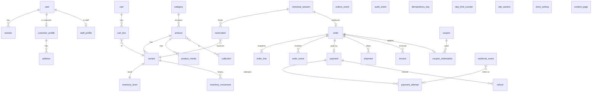
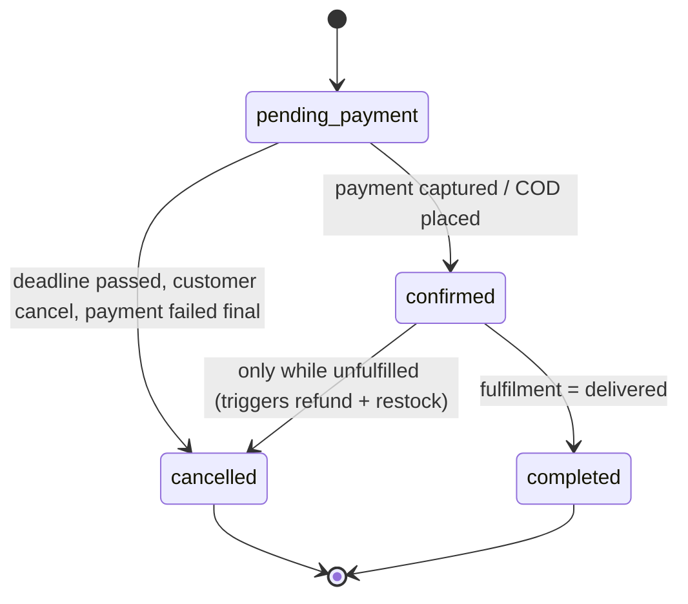
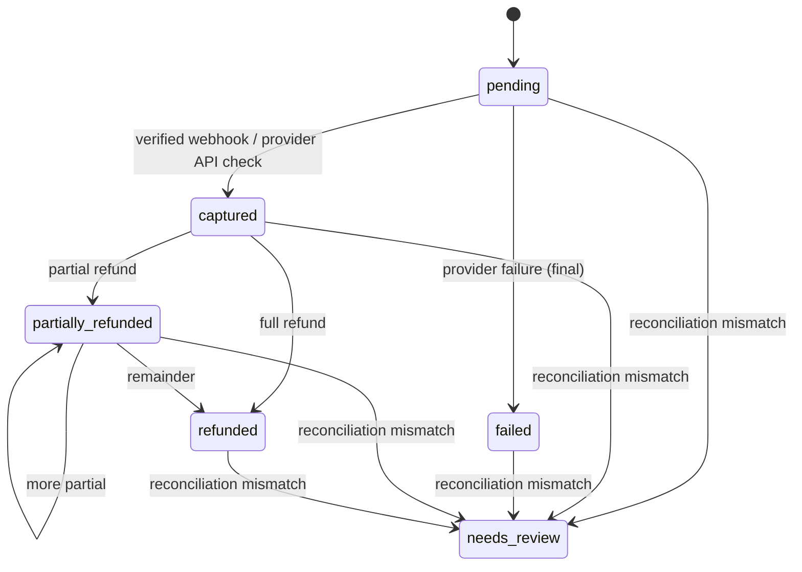

# DOPAMEAN Commerce Platform: SPEC (Phase 1, draft v0.1)

Date: 2026-10-16. Status: **awaiting owner approval. No application code exists or will be written until approved.**
Brief: the pasted "Build Brief" (referred to as "the brief"; § numbers refer to it).

Items marked **[ASSUMED]** are my proposals where the brief's business table was left blank. Items marked **[OPEN]** are decisions I need from the owner (collected in §13).

---

## 1. Discovery

### 1.1 Repo and environment

| Item                   | Finding                                                                                                                                                                                                        |
| ---------------------- | -------------------------------------------------------------------------------------------------------------------------------------------------------------------------------------------------------------- |
| Repo                   | `D:\cloth`, git, branch `main`, clean. 20+ commits, all front-end work. Author: Shiv Ranjan.                                                                                                                   |
| What exists            | A **static front end only** for the brand **DOPAMEAN**: 3 pages, 7 CSS files (~125 KB), 1 JS file (~12 KB), fonts, images, 1 video. No backend, no build tooling, no package.json, no tests, no CI, no Docker. |
| Pages                  | `index.html` (home), `collection_page.html` (shop-all grid), `products.html` (product detail).                                                                                                                 |
| Stack of existing code | Hand-written CSS (global class names), vanilla JS, desktop and mobile DOM trees both present and switched by media queries (`@media` 768 / 1023 / 1024 px).                                                    |
| Fonts                  | Apercu Pro, Apercu Mono Pro, Satoshi (local woff/woff2). Some CSS also references Roboto Mono, Source Code Pro, Courier New (not bundled, falls back). **Font licences must be checked** (see §13, Q12).       |
| Images                 | 10 product-style model photos (`product1 (N).png`), logos, footer art, one video. No licence info. Treated as placeholder assets.                                                                              |
| README                 | Says MIT licence.                                                                                                                                                                                              |
| Machine                | Windows 10, 4 logical CPUs, 48 GB RAM, Node 22.19.0, npm 10.9.3, Docker CLI 29.8.2.                                                                                                                            |
| **Not available now**  | Docker daemon is **not running** (named pipe missing), `psql` not installed, `pnpm` not installed. Postgres, MinIO, Mailpit and Testcontainers all need Docker running.                                        |

### 1.2 Design inventory (this is the design that must not change)

| Page       | Regions                                                                                                                                                                                                                                                                                                                                                                                                                                                                                                                                                                                                                                                                                                                                                                  |
| ---------- | ------------------------------------------------------------------------------------------------------------------------------------------------------------------------------------------------------------------------------------------------------------------------------------------------------------------------------------------------------------------------------------------------------------------------------------------------------------------------------------------------------------------------------------------------------------------------------------------------------------------------------------------------------------------------------------------------------------------------------------------------------------------------ |
| Home       | Scrolling top banner (FREE SHIPPING / CASH ON DELIVERY / NOW LIVE) + header buttons (Shop Now, Contact Us, Dark mode); left side-nav boxes (logo, links Shop all / APPAREL / TOP WEAR / BOTTOM WEAR / NEW IN, SEARCH[....], ACCOUNT, BAG[0]); hero text + SHOP NOW; mobile header with hamburger and marquee; NEW ARRIVALS horizontal product scroller (4 cards); "qualified for free shipping" notification bar; 2 collection tiles; NEW ARRIVALS grid (6 cards); SHOP NOW bar; video; desktop footer (contact, newsletter form, perks, link columns, legal, live clock) and a separate mobile accordion footer; slide-in **shopping bag drawer** (item list, qty +/-, remove, "WHY NOT ADD?" suggestions with sale prices, SECURE CHECKOUT button, CONTINUE SHOPPING). |
| Collection | Same shell; FILTER / SORTED BY bar (text only); 3 product grid blocks of 4 cards; same footers and bag.                                                                                                                                                                                                                                                                                                                                                                                                                                                                                                                                                                                                                                                                  |
| Product    | Same shell; image scroller + thumbnails (desktop), mobile gallery with sticky dock; title, size selector XS..XXXL, SIZE GUIDE modal, add-to-bag with price, accordions / tabs (MATERIALS, SHIPPING & RETURNS, CARE GUIDE); same footers and bag.                                                                                                                                                                                                                                                                                                                                                                                                                                                                                                                         |

Visual language to reuse for any new screen: monospace Apercu Mono labels, `[ RS. 15,000 ]` bracket price format, `[....]` motifs, hard-edged dark and light boxes, uppercase copy, `▪` bullets. Design tokens will be **extracted from the existing CSS** into one file (§10 of the brief) without altering the existing CSS.

### 1.3 Defects found in existing front end (to be handled during the port, listed so they are not mistaken for regressions)

1. `script/script.js` runs on every page but dereferences elements that exist on only some (e.g. `sizeGuideLink.addEventListener` throws on pages without `.size-guide`; `.overlay` is looked up but not present in `index.html`). Everything after the first throw on that page never runs.
2. Several handlers are registered twice or collide (`.accordion-header` handled by three separate blocks, `.size-btn` / `.size-selector button` handled in parallel). Accordion toggling can double-fire.
3. Prices are inconsistent in format (`[ RS. 15,000 ]` vs `[RS.12.000]`), the footer says `© 2024`, "AVAILIABLE" and "CONTUNIE SHOPPING" are typos, `PINTREST` is misspelt. These are **content**, not design; I will fix typos only if you say so (§13 Q14), because you asked for the design to stay exact.
4. Many controls do nothing: SEARCH, ACCOUNT, Dark mode, FILTER, SORTED BY, Contact Us, Wishlist-me-now form, all footer links, the bag content (hard-coded), SECURE CHECKOUT, size-chart is a static image/table. Brief §0.4 forbids shipping buttons that do nothing, so each needs a decision (§13 Q14).
5. Desktop and mobile trees duplicate the same content (e.g. two footers, two product galleries). The port will render both from the same data so they cannot drift.

### 1.4 Gap between the brief and the existing design

| Brief requires                             | Existing design has                                               | Plan                                                                                                |
| ------------------------------------------ | ----------------------------------------------------------------- | --------------------------------------------------------------------------------------------------- |
| Search with PostgreSQL FTS                 | Text label `SEARCH[....]` only                                    | Wire the label as the trigger for a search overlay/page. New UI, styled with tokens. [OPEN Q11]     |
| Filters, sort, pagination in URL           | Text `FILTER` / `SORTED BY` only                                  | Same: wire these two labels to panels.                                                              |
| Account, sign-up, login, orders, addresses | `ACCOUNT` link only                                               | New screens (§9.2).                                                                                 |
| Checkout, order confirmation               | `SECURE CHECKOUT` button only                                     | New screens.                                                                                        |
| Coupons                                    | Newsletter promises "15% off first purchase"                      | See Q14.                                                                                            |
| Staff admin                                | Nothing                                                           | New (Tailwind/shadcn, dense tables).                                                                |
| Returns                                    | Footer "EXCHANGES/RETURNS" link, product tab "SHIPPING & RETURNS" | R1 shows static policy content only (returns/RMA is R2).                                            |
| Out of scope per §3                        | Footer "GIFT CARDS" link; "WISHLIST ME NOW"                       | Gift cards are a non-goal. Link must be removed or point to a notice page. Needs your ruling (Q14). |

---

## 2. Business decisions

| Decision          | Value used in this spec                                                                                                                    | Source                                                                         |
| ----------------- | ------------------------------------------------------------------------------------------------------------------------------------------ | ------------------------------------------------------------------------------ |
| Store / brand     | **DOPAMEAN**                                                                                                                               | Repo. [Q1: confirm legal name]                                                 |
| Country, currency | India, **INR**, single currency. Seller location Panipat, Haryana (footer).                                                                | Repo + brief example. [Q2: confirm, plus GSTIN and seller state code]          |
| Tax               | GST, prices **tax-inclusive**, CGST+SGST intra-state, IGST inter-state, HSN + rate per product                                             | Brief example **[ASSUMED]**. Slab rule needs accountant input, see §4.3 and Q3 |
| Tax invoice       | GST invoice PDF, consecutive numbering per financial year (Apr to Mar)                                                                     | Brief example **[ASSUMED]**, Q4                                                |
| Payment provider  | Razorpay, test mode                                                                                                                        | Brief example **[ASSUMED]**, Q5 (need test keys)                               |
| COD               | Yes (banner and footer advertise it). Max order value and serviceable pincodes: **[OPEN]**                                                 | Repo, Q6                                                                       |
| Shipping          | Banner says "FREE SHIPPING ON ALL ORDERS" but bag says "SUCCESS! YOU'VE QUALIFIED FOR FREE SHIPPING" which implies a threshold. **[OPEN]** | Repo, Q7                                                                       |
| Email             | Provider **[OPEN]**; local dev uses Mailpit                                                                                                | Q8                                                                             |
| Hosting           | Docker Compose on one VPS: web + worker + Postgres + MinIO                                                                                 | Brief example **[ASSUMED]**, Q9                                                |
| Scale target      | 5,000 products / 20,000 variants, 500 orders/day, peak 30 checkouts/min                                                                    | Brief example **[ASSUMED]**, Q10                                               |
| Brand assets      | Existing design, fonts, logos                                                                                                              | Repo (Q11/Q12 for licences)                                                    |
| License           | MIT                                                                                                                                        | README, Q12                                                                    |
| Languages         | English only                                                                                                                               | Q13                                                                            |

The brief says to ask before finishing Phase 1 if any row is blank. Rows above are therefore **provisional**; the spec is not final until you answer §13.

---

## 3. User journeys

### 3.1 Customer

1. **Browse**: Home (admin-configurable sections) → "Shop all" / category / collection → filter, sort, paginate (state in URL) → product page.
2. **Search**: `SEARCH[....]` → query → FTS results (same grid component) with filters.
3. **Product**: gallery, size selection, stock-aware quantity (cannot exceed available), price, shipping and returns info, add to bag.
4. **Bag (drawer)**: guest or signed-in. Lines show live price and stock state. On sign-in the guest bag **merges** into the account bag (same variant → quantities summed, capped at available).
5. **Checkout** (guest or account): email + phone, shipping address, shipping method (flat/free), payment method (online / COD where eligible), coupon, review with server-computed totals → place order.
   - If anything changed since the bag was loaded the customer sees a diff and must confirm (INV-12).
   - Online: redirected to Razorpay hosted checkout → returns to `/checkout/return` which only **reads status from DB**; the confirmation page shows paid only after the webhook (or a server-side provider check) has captured.
   - COD: order confirmed immediately; payment stays `pending` until admin marks collected.
6. **Confirmation**: built from server state, with order number and email sent.
7. **Account**: register, verify email, login, reset password, addresses, order history, order detail (status, tracking), **cancel request before shipment**, data export, delete account.
8. **After sale**: shipped email with carrier and tracking number; order detail shows tracking.

### 3.2 Staff

- **Owner**: everything, plus staff management, settings, 2FA required.
- **Manager**: catalog, inventory, orders, coupons, refunds, reports; no staff management/settings (payment/tax/email); 2FA required.
- **Support**: can view orders and customers and add order notes. Cannot refund, cancel, mark shipped, change prices or stock, or manage staff (matrix in §8.3; shipping rights are Q14b).
- Staff accounts are created by an Owner only. First Owner is bootstrapped by a one-time CLI command (`npm run staff:create-owner`), never via public sign-up.

### 3.3 System

Webhook handling, outbox relay, reservation expiry, payment reconciliation, email sending, abandoned bag cleanup, rate-limit pruning, nightly invoice/reports are all worker jobs (pg-boss).

---

## 4. Business rules

### 4.1 Money

- `Money` = `{ amount: bigint-safe integer minor units (paise), currency: 'INR' }`. No floats in any money path. Arithmetic via Money helpers only; lint rule forbids `*`/`/` on money-typed values outside the helper module.
- DB columns: `bigint` paise.
- Display: formatter yields the existing style `[ RS. 15,000 ]` (Indian digit grouping).

### 4.2 Pricing pipeline (single function, pure TypeScript, in `pricing`)

`priceCart(lines, coupon?, shippingAddress, paymentMethod) → Quote`

1. Line gross = unit price (tax-inclusive, from DB, **or** variant price override) × qty.
2. Coupon discount allocated across eligible lines (percent: per-line rounding half-up, remainder to the largest line; fixed: pro-rata by gross, remainder to the largest line). Discount can never exceed the eligible gross.
3. Shipping: flat rate or free over threshold (Q7), computed after discount, inclusive of tax rules in §4.3 (shipping is taxable at the highest rate of the goods in the cart under GST composite supply rules; **[OPEN Q3]**).
4. Tax extraction per line (rule in §4.3).
5. Grand total = Σ(line gross − line discount) + shipping (+ COD fee if Q6 says so).
6. Quote carries a `pricingToken` = HMAC of {variant ids, qty, unit prices, stock availability flags, coupon, totals}. The client echoes the token on "place order". Server recomputes; mismatch → `PRICE_CHANGED` / `STOCK_CHANGED` with the diff (INV-12). The client-sent total is **never** used (INV-01).

### 4.3 Tax (GST) **[ASSUMED, needs accountant sign-off: ADR 0002 to be written]**

- Rate stored as integer **basis points** (500 = 5%) plus HSN code on each product. Seller state vs shipping-address state decides CGST+SGST (intra) or IGST (inter).
- Because prices are tax-inclusive: `tax = round_half_up(taxable_gross × rate_bp / (10000 + rate_bp))` computed **per line after discount**, on the line total (not per unit). `net = gross − tax`.
- Intra-state split: `CGST = floor(tax / 2)`, `SGST = tax − CGST` (paise remainder goes to SGST). IGST = tax.
- Order tax total = Σ line tax (never recomputed from the order total).
- **Open point:** Indian apparel GST has historically been **price-slab based** (rate depends on the unit price) and slabs were revised recently. If the slab applies, the rate is a function of the unit price, not a fixed per-product value. The `tax` module will therefore support a `slab` rule (threshold + two rates) in addition to a fixed rate. Please confirm the current rules with your accountant (Q3).
- Everything above is unit-tested with table-driven cases including odd-paise remainders.

### 4.4 Inventory and reservations

- Per variant: `on_hand`, `reserved`; `available = on_hand − reserved`.
- Reserve is **one atomic conditional UPDATE** (`SET reserved = reserved + q WHERE variant_id = $1 AND on_hand − reserved >= q`; zero rows → `OUT_OF_STOCK`). A `CHECK (on_hand >= 0 AND reserved >= 0 AND reserved <= on_hand)` constraint is the last line of defence (INV-03).
- Reservation created at **checkout start** (not at add-to-bag), expires in **15 minutes** (config `RESERVATION_TTL_MINUTES`), released by a worker job in the same transaction that marks the reservation `expired`.
- On order confirmation: `on_hand −= q`, `reserved −= q`, movement row `sale`. On release: `reserved −= q`.
- Every change writes an `inventory_movement` row (reason: adjustment, sale, reservation_release, cancellation_restock, refund_restock, correction; actor; before/after).
- COD: reserve at placement, commit immediately (order is `confirmed`).
- Admin adjustments cannot take `on_hand` below current `reserved`.

### 4.5 Late-payment handling (INV-05, INV-10) **[ASSUMED, high impact, please review]**

The order must never move backwards (`cancelled → confirmed` is illegal), so expiry is split in two:

1. **t+15 min**: reservation expires, stock is released. **Order stays `pending_payment`.**
2. **t+30 min**: reconciliation asks the provider about any attempt still `pending`.
3. **t+60 min** (config `ORDER_PAYMENT_DEADLINE_MINUTES`): if still unpaid the order goes `pending_payment → cancelled` and the provider order is closed.

- Payment captured between t+15 and t+60: try to re-reserve. Success → order `confirmed`. Failure → auto-refund (idempotent), payment `captured → refunded`, order `cancelled`, notify customer and admin.
- Payment captured **after** cancellation: record it, mark payment `needs_review`, auto-refund, notify admin.

### 4.6 Orders, cancellation, fulfilment

- Order number: human-readable, sequential, non-guessable public ID is separate (`public_id` ULID). URLs use `public_id`; guest order lookup requires `public_id` + email token.
- Customer **cancel request** before shipment: allowed while fulfilment = `unfulfilled`; for `confirmed` online-paid orders it cancels immediately and starts a full refund (policy question Q15: auto-approve vs staff-approve; default auto-approve while unfulfilled). Cancel after shipped → `ORDER_NOT_CANCELLABLE` (INV-09).
- Admin marks shipped (carrier + tracking number, entered manually in R1) → fulfilment `shipped`, shipped email; marks delivered → fulfilment `delivered`, order `completed`.
- Stock restock on cancel is automatic for unshipped orders.

### 4.7 Refunds

- Full or partial; admin chooses amount (≤ captured − already refunded) and optional "restock" per line.
- Row `refund(status=requested, idempotency_key)` is written **before** the provider call, updated to `succeeded|failed` **after**. Provider call carries the idempotency key. A job retries rows stuck in `requested`.
- `Σ refunded ≤ captured` enforced by a DB check inside the refund transaction with row lock on the payment (INV-09).
- COD orders: refund is recorded as an offline refund (no provider call); only after collection.

### 4.8 Coupons

- Types: percent, fixed. Fields: code (case-insensitive unique), min spend, total usage limit, per-customer limit, starts/ends, active, optional eligible scope (all products in R1).
- Redemption row is written in the **checkout transaction** with `UPDATE coupon SET used_count = used_count + 1 WHERE id=$1 AND (max_uses IS NULL OR used_count < max_uses)`; per-customer limit enforced with a count under a per-(coupon, customer) advisory lock (guests keyed by verified email hash). Redemption is released if the order is cancelled **unpaid**; it is kept if cancelled after payment (INV-11).
- Errors: `COUPON_INVALID`, `COUPON_EXPIRED`, `COUPON_NOT_STARTED`, `COUPON_MIN_SPEND`, `COUPON_LIMIT_REACHED`, `COUPON_CUSTOMER_LIMIT`.

### 4.9 Invoices

- Generated by the worker when an order becomes `confirmed` (online) or on dispatch (COD), PDF stored in S3-compatible storage, number from a Postgres sequence **per financial year** (`INV/2026-27/000001`), gapless is guaranteed by allocating inside the same transaction as the invoice row (no gaps on rollback because the counter row is updated, not a sequence). Credit notes for refunds follow the same scheme. **Rules to be confirmed by your accountant (Q4); I make no tax-compliance claim.**

### 4.10 Catalog

- Product: name, slug, description, status (draft / published / archived), category, collections, HSN, tax rule, media, SEO fields, size-guide reference, materials/care/shipping-returns tab content.
- Variant: SKU (unique), option values (Size XS..XXXL; colour optional, Q16), price, compare-at price (drives the struck-through "sale" price seen in the bag suggestions), weight (reserved for future), barcode optional.
- Only `published` products appear in the storefront, sitemap, search. Archiving keeps past orders intact (INV-07).
- Soft delete only for products that have ever been ordered; hard delete otherwise.

### 4.11 Search

- Generated `tsvector` column (name weight A, category/collection B, description C) with GIN index, `websearch_to_tsquery('simple', …)` + `ts_rank`. Prefix matching via `pg_trgm` for typo tolerance on name only. Page size ≤ 100 (default 24).

### 4.12 Customer data

- Export (JSON) and deletion. Orders and invoices required by law (GST records) are **retained but anonymised** (name/phone/email replaced, address lines blanked except state/pincode needed for tax) after account deletion. Retention period is a legal question (Q4).

### 4.13 Rate limits (Postgres-backed, fixed window)

Login 10/15 min per IP+email; sign-up 5/hour per IP; password reset 5/hour per email+IP; coupon apply 20/10 min per session; checkout 10/10 min per session/IP; webhook endpoint exempt but size-limited.

---

## 5. Data model (ERD)

Module ownership is shown by prefix. No module reads another module's tables directly (§7).

### 5.1 Tables (key columns; full DDL in Phase 2 migrations)

| Module             | Table                                                                                                                                                                                                                                                                                                                                                                                                                                 | Key columns / constraints                                     |
| ------------------ | ------------------------------------------------------------------------------------------------------------------------------------------------------------------------------------------------------------------------------------------------------------------------------------------------------------------------------------------------------------------------------------------------------------------------------------- | ------------------------------------------------------------- |
| auth (Better Auth) | `user`, `session`, `account`, `verification`, `two_factor`                                                                                                                                                                                                                                                                                                                                                                            | Better Auth schema. DB sessions; session rotation on login.   |
| customers          | `customer_profile` (user_id PK, phone, marketing_opt_in, deleted_at), `address` (customer_id, name, line1/2, city, state_code, pincode, phone, is_default)                                                                                                                                                                                                                                                                            | Address access scoped by customer_id in every query (INV-13). |
| staff              | `staff_profile` (user_id PK, role enum owner/manager/support, active, created_by)                                                                                                                                                                                                                                                                                                                                                     | Roles checked server-side.                                    |
| catalog            | `category` (parent_id, slug unique), `collection`, `collection_product`, `product` (slug unique, status, hsn, tax_rule_id, search_vector, …), `product_option` / `option_value`, `variant` (sku unique, price_paise, compare_at_paise, options jsonb), `product_media` (object_key, alt, w, h, position)                                                                                                                              | `CHECK (price_paise > 0)`. GIN on `search_vector`.            |
| inventory          | `inventory_level` (variant_id PK, on_hand, reserved), `inventory_movement`, `reservation` (checkout_session_id, variant_id, qty, status held/committed/released/expired, expires_at)                                                                                                                                                                                                                                                  | Checks in §4.4. Index on `(status, expires_at)`.              |
| pricing / tax      | `tax_rule` (id, kind fixed/slab, rate_bp, slab_threshold_paise, rate_bp_above)                                                                                                                                                                                                                                                                                                                                                        |                                                               |
| cart               | `cart` (id, customer_id null, anon_token_hash, updated_at), `cart_line` (cart_id, variant_id, qty; unique(cart_id, variant_id))                                                                                                                                                                                                                                                                                                       | Prices are **not** stored on cart lines.                      |
| checkout           | `checkout_session` (id, cart snapshot, quote jsonb, pricing_token, expires_at, status)                                                                                                                                                                                                                                                                                                                                                | Short-lived.                                                  |
| orders             | `order` (id, public_id, number, customer_id null, email, status, fulfillment_status, totals, shipping_address jsonb snapshot, coupon snapshot, idempotency_key unique, placed_at), `order_line` (snapshot: product_name, variant_options, sku, unit_price, qty, discount, tax_rate_bp, tax_amount, cgst/sgst/igst, hsn, image key), `order_event` (type, actor, payload)                                                              | Snapshots only; **no FK dependence for display** (INV-07).    |
| payments           | `payment` (order_id unique, method online/cod, status, amount_paise, captured_paise, refunded_paise, provider, provider_order_id), `payment_attempt` (payment_id, provider_order_id, provider_payment_id, status, created_at), `webhook_event` (provider, **provider_event_id UNIQUE**, raw_body, signature_ok, received_at, processed_at), `refund` (payment_id, amount, status, idempotency_key unique, provider_refund_id, reason) | `CHECK (refunded_paise <= captured_paise)`.                   |
| fulfillment        | `shipment` (order_id, carrier, tracking_no, shipped_at, delivered_at)                                                                                                                                                                                                                                                                                                                                                                 |                                                               |
| promotions         | `coupon`, `coupon_redemption` (coupon_id, customer_key, order_id)                                                                                                                                                                                                                                                                                                                                                                     |                                                               |
| notifications      | `notification_log` (template, to_hash, order_id, status), templates in code                                                                                                                                                                                                                                                                                                                                                           |                                                               |
| audit              | `audit_event` (actor_user_id, actor_role, action, entity, entity_id, before jsonb, after jsonb, ip, user_agent, at)                                                                                                                                                                                                                                                                                                                   | Append-only (no UPDATE/DELETE grants for the app role).       |
| platform           | `outbox_event` (aggregate, type, payload, created_at, relayed_at), `idempotency_key` (key, scope, request_hash, response, created_at), `rate_limit_counter` (key, window_start, count), `site_section` (home page sections: type, config jsonb, position, active), `store_setting`, `content_page` (faq, shipping, size charts, legal), `invoice_counter` (financial_year, last_no)                                                   | pg-boss keeps its own schema.                                 |

---

## 6. State machines

### 6.1 Order

### 6.2 Payment

`needs_review` exits only by an Owner/Manager resolution action that writes an audit event and moves to the verified state. COD: `pending` until admin marks collected → `captured`.

### 6.3 Fulfilment

`unfulfilled → shipped → delivered`. No reversal in R1 (returns are R2).

### 6.4 Reservation

`held → committed | released | expired`. Terminal states are final.

### 6.5 Rules shared by all machines (INV-05, INV-08)

- Transitions are a typed table in the module's domain code; the only way to change status is `transition(current, event)`; illegal → `IllegalTransitionError` (stable code `ILLEGAL_TRANSITION`).
- Persisted with `UPDATE … WHERE id=$1 AND status=$expected` (optimistic); 0 rows → re-read and re-evaluate (so a late event for a state already passed is a **no-op**, not a regression).
- Events carry a provider timestamp/sequence where available; a lower-rank event after a higher-rank state is ignored and logged.

---

## 7. Architecture

- Next.js (App Router) + React + TypeScript strict. **Modular monolith** in `src/modules/{catalog,inventory,pricing,tax,cart,checkout,payments,orders,fulfillment,promotions,customers,staff,notifications,audit}`; each exposes only `index.ts`; dependency-cruiser fails CI on cross-module imports into non-index files or on direct table access (tables are exported only from the owning module's `schema.ts`, not re-exported).
- Domain code (`domain/`) is plain TS: no Next.js, no Drizzle, no provider SDK imports (enforced by lint boundaries).
- Handlers/server actions: validate (Zod) → authorize → call module → map result to a stable error code.
- Worker: separate Node entry (`src/worker/index.ts`) from the same codebase, using pg-boss. Outbox rows are inserted in the same transaction as the business change; a relay job publishes them (emails, invoices, audit side effects).
- Payment provider and email are behind small interfaces (`PaymentProvider`, `Mailer`); a fake provider exists **only** under `tests/`.
- Storage: S3 API (MinIO locally). Uploads: size limit, magic-byte sniffing, re-encoded via `sharp` (strips metadata), SVG rejected.
- Observability: pino JSON logs with `requestId`, redaction of PII/secrets, `/api/health` (DB, worker heartbeat, storage), optional Sentry via env.
- Compose services: `web`, `worker`, `postgres`, `minio`, `mailpit`. CI runs the same with Testcontainers or Compose.
- Versions: current stable at project start, recorded in ADR 0002 on day 1 of Phase 2 (I will not pin versions from memory).

---

## 8. Routes, APIs, errors

Public third-party API is a non-goal; the only externally-facing HTTP contracts are webhooks, health, sitemap/robots. Everything else is server actions or internal route handlers.

### 8.1 Storefront pages (SSR/ISR; SEO metadata, canonical, JSON-LD on products)

| Route                                                                                                 | Replaces               | Notes                                                                    |
| ----------------------------------------------------------------------------------------------------- | ---------------------- | ------------------------------------------------------------------------ |
| `/`                                                                                                   | `index.html`           | Sections from `site_section`                                             |
| `/collections/[slug]` and `/collections/all`                                                          | `collection_page.html` | `?sort=&filter=&page=` in URL; page size ≤ 100                           |
| `/products/[slug]`                                                                                    | `products.html`        | Product + Offer JSON-LD                                                  |
| `/search?q=`                                                                                          | new                    | FTS                                                                      |
| `/checkout`, `/checkout/return`, `/orders/[publicId]/confirmation`                                    | new                    | Confirmation from DB state only                                          |
| `/login`, `/register`, `/verify-email`, `/forgot-password`, `/reset-password`                         | new                    | Better Auth                                                              |
| `/account`, `/account/orders`, `/account/orders/[publicId]`, `/account/addresses`, `/account/privacy` | new                    | Auth required, ownership enforced                                        |
| `/pages/[slug]`                                                                                       | footer links           | FAQ, shipping, size charts, product care, about, contact, terms, privacy |
| `/sitemap.xml`, `/robots.txt`                                                                         | new                    | Published products/collections only                                      |

### 8.2 Internal operations (server actions / route handlers)

`cart.add|updateQty|remove|merge|get`, `coupon.apply|remove`, `checkout.quote`, `checkout.placeOrder` (requires `Idempotency-Key`), `payments.createProviderOrder`, `orders.requestCancel`, `account.*`, and admin equivalents under `/admin/*`.

External: `POST /api/webhooks/razorpay` (raw body, signature verify, store, dedupe, 2xx quickly, process via state machine), `GET /api/health`.

### 8.3 Admin and role matrix

Pages: dashboard (sales report with written metric definitions), products, inventory + low-stock, orders (server-side search/filter/sort/pagination), order detail + timeline, coupons, customers, home sections, content pages, staff, audit log, settings.

| Action                              | Owner | Manager    | Support                          |
| ----------------------------------- | ----- | ---------- | -------------------------------- |
| View orders / customers             | yes   | yes        | yes                              |
| Add order note                      | yes   | yes        | yes                              |
| Mark shipped / delivered            | yes   | yes        | no (**[OPEN Q14b]**, default no) |
| Cancel order                        | yes   | yes        | no                               |
| Refund                              | yes   | yes        | **no** (tested)                  |
| Edit catalog / inventory            | yes   | yes        | no                               |
| Coupons                             | yes   | yes        | no                               |
| Staff, settings, payment/tax config | yes   | no         | no                               |
| View audit log                      | yes   | yes (read) | no                               |

### 8.4 Stable error codes (shared by API and UI)

`VALIDATION_FAILED`, `UNAUTHENTICATED`, `FORBIDDEN`, `NOT_FOUND`, `RATE_LIMITED`, `CSRF_FAILED`, `IDEMPOTENCY_CONFLICT`,
`OUT_OF_STOCK`, `STOCK_CHANGED`, `PRICE_CHANGED`, `CART_EMPTY`, `QTY_EXCEEDS_AVAILABLE`, `PRODUCT_UNAVAILABLE`,
`COUPON_INVALID`, `COUPON_EXPIRED`, `COUPON_NOT_STARTED`, `COUPON_MIN_SPEND`, `COUPON_LIMIT_REACHED`, `COUPON_CUSTOMER_LIMIT`,
`PINCODE_NOT_SERVICEABLE`, `COD_NOT_AVAILABLE`, `COD_LIMIT_EXCEEDED`,
`PAYMENT_FAILED`, `PAYMENT_SIGNATURE_INVALID`, `PAYMENT_PENDING`, `REFUND_EXCEEDS_CAPTURED`, `REFUND_FAILED`,
`ORDER_NOT_CANCELLABLE`, `ILLEGAL_TRANSITION`, `RESERVATION_EXPIRED`,
`EMAIL_NOT_VERIFIED`, `ACCOUNT_LOCKED`, `TWO_FACTOR_REQUIRED`.

---

## 9. Design handling

### 9.1 Existing pages (no design change)

Port per ADR 0001: legacy CSS copied unchanged, markup translated 1:1 to React, data bound. **Proof of "unchanged"**: before any port, capture Playwright baselines from the current static files at 375 / 768 / 1280 / 1920 px; ported pages must match within a pixel-diff threshold. Any unavoidable difference is listed in PROGRESS.md for your approval.

Data binding (the only differences): product name/price/images/links, collection names/counts, bag contents, "BAG[n]", size availability (out-of-stock sizes shown with the existing disabled/greyed treatment if one exists, else flagged to you), live clock, copyright year.

### 9.2 New screens without a design (need your decision, Q11)

Login/register/reset, account, orders, addresses, checkout, confirmation, search results, filter/sort panels, 404/500, content pages. Proposal: build them in the existing visual language (mono labels, bracket motifs, dark/light boxes, same fonts and tokens) and show screenshots at the Phase 3 checkpoint for approval **before** moving on. If you have a Figma or reference for these, I will use it instead.

### 9.3 Admin

Tailwind + shadcn/ui, dense table-first, tokens aligned with the brand (same fonts). Every screen: loading / empty / error / success states; destructive actions confirm and state their effect.

### 9.4 Cross-cutting

`prefers-reduced-motion` respected (the existing marquee and accordion animations will be disabled under it, which is an accessibility behaviour not a visual redesign), explicit image width/height to avoid layout shift, WCAG 2.2 AA via axe. The existing CSS may fail some AA checks (e.g. contrast, focus visibility); where it does, I will **report** it and propose the smallest additive fix rather than silently altering the design.

---

## 10. Payment flow (Razorpay test mode **[ASSUMED]**)

As the brief §7, concretely:

1. `placeOrder` (Idempotency-Key) → in one transaction: re-price, verify token, reserve stock, redeem coupon, create `order(pending_payment)`, `payment(pending)`, outbox `order.placed`.
2. After commit: create provider order with the server amount; store `payment_attempt`.
3. Customer pays in Razorpay hosted checkout.
4. Return URL: server verifies the returned signature **only to show a "processing" state**; status always read from DB. A redirect never marks paid (INV-02).
5. Webhook: verify HMAC on raw body → insert `webhook_event` (unique provider_event_id; duplicate → 200 no-op) → apply via state machine in a transaction (INV-04, 05).
6. Reconciliation job: attempts `pending` > 30 min → provider API → apply or flag `needs_review`.
7. Refund as §4.7.
   Not verifiable without credentials: live provider round-trip. Until test keys are supplied (Q5) the provider integration is **Implemented but unverified**, with a fake provider used only in automated tests.

---

## 11. Threat model (short, STRIDE-oriented; ASVS L2 as checklist, no compliance claim)

| Asset / surface  | Threat                                      | Mitigation                                                                       | Test                              |
| ---------------- | ------------------------------------------- | -------------------------------------------------------------------------------- | --------------------------------- |
| Order amounts    | Tampered price/qty/total in request         | Server pricing from DB; token check; ignore client totals                        | tamper tests (INV-01)             |
| Payment status   | Forged "paid" via redirect/webhook          | Signature on raw body; server-side provider check; unique event id               | missing/invalid signature, replay |
| Stock            | Race → oversell                             | Atomic conditional update + CHECK                                                | 20 concurrent (INV-03)            |
| Coupons          | Concurrent over-redemption, enumeration     | Atomic counter, rate limit, generic errors                                       | INV-11, rate-limit test           |
| Customer data    | IDOR on orders/addresses                    | Ownership in query predicate (not after fetch); `publicId` unguessable           | INV-13                            |
| Admin            | Privilege escalation, support doing refunds | Server-side role check in every action; 2FA for Owner/Manager                    | role tests                        |
| Accounts         | Credential stuffing, brute force            | argon2id/scrypt, rate limits, lockout, generic messages                          | rate-limit test                   |
| Sessions         | Fixation, CSRF                              | Rotate on login, HttpOnly/Secure/SameSite, CSRF tokens/Origin check on mutations | CSRF test                         |
| Uploads          | Malware/SVG XSS/oversize                    | Size cap, sniffing, re-encode, no SVG                                            | upload tests                      |
| Output           | XSS via product/review/admin text           | React escaping, CSP, sanitised rich text (allow-list)                            | CSP/XSS test                      |
| Secrets/logs     | Leakage                                     | Env only, `.env.example` blank, log redaction, secret scan in CI                 | scan in CI                        |
| Webhook endpoint | DoS/oversize                                | Body size cap, rate limit by IP, cheap rejection before DB                       |                                   |
| Supply chain     | Vulnerable deps                             | `npm audit` + lockfile + Dependabot/Renovate in CI                               | CI gate                           |
| Emails           | Header injection, token leaks               | Fixed templates, single-use hashed tokens with expiry                            |                                   |
| PII              | Retention/privacy                           | Export/delete flow, anonymisation                                                | account tests                     |
| Availability     | Postgres loss                               | Backup script + tested restore drill                                             | drill                             |

Residual risks to be reported at the end: single VPS (no HA), provider test mode only, manual shipping, and legal/tax points awaiting accountant review.

---

## 12. Quality plan

- **Gates** (CI, blocking): format, lint + module boundaries, typecheck, unit, integration on **real Postgres**, Playwright E2E critical journey + axe, production build, migrate from empty DB, `npm audit` + secret scan.
- **Tests per invariant**: see `docs/INVARIANTS.md`.
- **Design preservation**: visual baselines described in §9.1.
- **Performance** (reported with hardware, dataset, method): Lighthouse mobile LCP ≤ 2.5 s / CLS ≤ 0.1 / TBT ≤ 200 ms on a seeded catalog; category/search p95 ≤ 300 ms at the Q10 size, with EXPLAIN evidence; k6 checkout at peak rate for 10 min with 0 oversells and < 1% errors. **Caveat:** this machine is a Windows desktop (4 logical CPUs, 48 GB), not the production VPS spec (Q9), so numbers are reported as "dev hardware" and not as proof of production targets.
- **Layouts** checked at 375 / 768 / 1280 / 1920.
- **Phase 3 demo script** will drive the flow in §11 of the brief end-to-end.

### Phasing recap

1. Spec (this) → **STOP**.
2. Skeleton: Compose, DB, migrations, Better Auth, worker, CI, seed, visual baselines of the three existing pages.
3. Vertical slice (admin product → customer buys → webhook → ship → email) with INV-01..08, 10, 12 tests → **STOP + demo script**.
4. Complete R1 in the brief's order.
5. Hardening. 6. Release report → **STOP**.

---

## 13. Open questions (please answer or say "accept all proposed")

| #   | Question                                                                                                                                                                                                                                                                                                                                                                                                                                                                                                                                                                                                                                                                                                                        | Proposed default                                                                                                                                                                                                |
| --- | ------------------------------------------------------------------------------------------------------------------------------------------------------------------------------------------------------------------------------------------------------------------------------------------------------------------------------------------------------------------------------------------------------------------------------------------------------------------------------------------------------------------------------------------------------------------------------------------------------------------------------------------------------------------------------------------------------------------------------- | --------------------------------------------------------------------------------------------------------------------------------------------------------------------------------------------------------------- |
| Q1  | Legal/store name for invoices and emails?                                                                                                                                                                                                                                                                                                                                                                                                                                                                                                                                                                                                                                                                                       | DOPAMEAN                                                                                                                                                                                                        |
| Q2  | Seller GSTIN, registered state (for CGST/SGST vs IGST), registered address?                                                                                                                                                                                                                                                                                                                                                                                                                                                                                                                                                                                                                                                     | Haryana (Panipat); GSTIN: you provide                                                                                                                                                                           |
| Q3  | GST rate rules for apparel: fixed rate per product, or **price-slab** (rate depends on unit price)? Does shipping carry GST at the cart's rate? Who is the accountant to confirm?                                                                                                                                                                                                                                                                                                                                                                                                                                                                                                                                               | Support both; default slab per your accountant; shipping taxed at highest line rate                                                                                                                             |
| Q4  | Invoice format and numbering rules, and record-retention period?                                                                                                                                                                                                                                                                                                                                                                                                                                                                                                                                                                                                                                                                | Per FY `INV/2026-27/000001`, retain 8 years anonymised on deletion                                                                                                                                              |
| Q5  | Razorpay test key id/secret and webhook secret available? If not, provider code stays "implemented but unverified".                                                                                                                                                                                                                                                                                                                                                                                                                                                                                                                                                                                                             | Razorpay; you supply test keys                                                                                                                                                                                  |
| Q6  | COD: max order value, serviceable pincodes (list or "all India"), COD fee?                                                                                                                                                                                                                                                                                                                                                                                                                                                                                                                                                                                                                                                      | ₹5,000 max, all pincodes, no fee                                                                                                                                                                                |
| Q7  | Shipping: truly free on **all** orders (banner) or free above a threshold (bag message)? If a threshold, how much, and flat rate below it?                                                                                                                                                                                                                                                                                                                                                                                                                                                                                                                                                                                      | No sensible default: the site copy contradicts itself ("free on all orders" vs "qualified for free shipping"). Needs your answer.                                                                               |
| Q8  | Transactional email provider (SES, Resend, SMTP) and sending domain?                                                                                                                                                                                                                                                                                                                                                                                                                                                                                                                                                                                                                                                            | Resend or SMTP via env; Mailpit locally                                                                                                                                                                         |
| Q9  | Hosting spec of the VPS (CPU/RAM) for the performance targets?                                                                                                                                                                                                                                                                                                                                                                                                                                                                                                                                                                                                                                                                  | 2 vCPU / 4 GB                                                                                                                                                                                                   |
| Q10 | Scale targets: use 5,000 products / 20,000 variants / 500 orders/day / 30 checkouts/min?                                                                                                                                                                                                                                                                                                                                                                                                                                                                                                                                                                                                                                        | Yes                                                                                                                                                                                                             |
| Q11 | Brand assets are the existing design. Approve building **new screens** (login, account, checkout, search, filters, admin-facing storefront bits) in the existing visual language, with screenshots for approval at Phase 3? Or do you have designs?                                                                                                                                                                                                                                                                                                                                                                                                                                                                             | Approve                                                                                                                                                                                                         |
| Q12 | Licence: MIT? Do you hold licences for **Apercu / Apercu Mono (Colophon) and Satoshi** fonts and for the model photos/video? If not, the repo cannot ship them in an open-source release.                                                                                                                                                                                                                                                                                                                                                                                                                                                                                                                                       | MIT; you confirm font/image rights (otherwise I substitute open fonts, which **changes the design**, your call)                                                                                                 |
| Q13 | Languages: English only?                                                                                                                                                                                                                                                                                                                                                                                                                                                                                                                                                                                                                                                                                                        | Yes                                                                                                                                                                                                             |
| Q14 | Existing UI with no feature behind it. For each: **wire it** (new behaviour inside the existing look), **remove** (changes the design), or **leave as non-link static text**? (a) SEARCH, (b) ACCOUNT, (c) Dark mode toggle, (d) FILTER / SORTED BY, (e) Contact Us / footer CONTACT, (f) newsletter form "WISHLIST ME NOW" + "15% off first purchase", (g) GIFT CARDS link (non-goal), (h) Instagram/YouTube/Pinterest/LinkedIn/Facebook links (URLs?), (i) footer content links (FAQ, care, size charts, shipping, returns, about, visit us, environmental promises, terms, privacy): need real copy, (j) fix typos "AVAILIABLE", "CONTUNIE", "PINTREST", year "2024". Also: may **Support** role mark orders shipped (Q14b)? | Wire a–f, h; remove or notice-page g; i = placeholder legal-neutral copy flagged as "needs your text"; j = fix; newsletter = subscriber list + one-time welcome coupon (adds a small coupon/newsletter feature) |
| Q15 | Customer cancel before shipment: auto-approve (immediate refund) or staff approves?                                                                                                                                                                                                                                                                                                                                                                                                                                                                                                                                                                                                                                             | Auto-approve while unfulfilled                                                                                                                                                                                  |
| Q16 | Variant dimensions: size only (XS..XXXL) or size + colour?                                                                                                                                                                                                                                                                                                                                                                                                                                                                                                                                                                                                                                                                      | Size only (matches the design)                                                                                                                                                                                  |
| Q17 | Guest checkout without email verification OK? Account sign-up requires verification before first login to orders?                                                                                                                                                                                                                                                                                                                                                                                                                                                                                                                                                                                                               | Yes / yes                                                                                                                                                                                                       |
| Q18 | Approve the late-payment and two-step expiry design in §4.5 (high impact)?                                                                                                                                                                                                                                                                                                                                                                                                                                                                                                                                                                                                                                                      | Approve                                                                                                                                                                                                         |
| Q19 | Approve ADR 0001 (legacy CSS ported verbatim, Tailwind only for admin/new screens)?                                                                                                                                                                                                                                                                                                                                                                                                                                                                                                                                                                                                                                             | Approve                                                                                                                                                                                                         |

---

## 14. What I will not do without you

Start Phase 2; change any visible element of the three existing pages; add a dependency outside the locked stack; run any destructive migration or data deletion; call anything release-ready.
